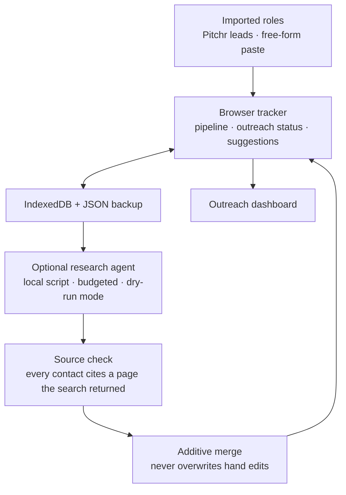

# CareerOS: Public Architecture Overview

**Project status:** CareerOS is a private project created by Arathi Seshan. This document describes its architecture and engineering decisions at a portfolio level. The source code, the research agent's prompts and search setup, and all candidate data are not public.

CareerOS is a local-first job-search tracker that runs in the browser, with no server or account. It follows every role through its pipeline and every outreach contact through reached-out, replied, and follow-up status. An optional research agent suggests contacts for each role and drafts a first message.

CareerOS tracks and suggests. It never sends a message and never logs into LinkedIn. Every message is reviewed and sent by the person.

The design followed four principles:

- Keep job-search data on the user's machine.
- Keep a person in the loop for anything that reaches another person.
- Make every suggested contact traceable to a source.
- Never let an automated update overwrite what the user wrote by hand.

## What the system does

- **Pipeline tracking:** each role has a stage, outcome, dates, priority, contact, and next action.
- **Outreach tracking:** each contact has its own status, and the tracker suggests who to follow up with, who is waiting on the user, and who to try next. Suggestions are never applied automatically.
- **Outreach dashboard:** reply rates, time to reply, and breakdowns by company and kind of contact.
- **Importing:** leads come in from Pitchr, my career-strategy platform, or as free-form pasted roles from any other source.
- **Optional research agent:** for roles that need a contact, it proposes people to try, in order, with a role summary and a draft message.

## High-level architecture

## Key design decisions

### Local-first, in the browser

The tracker is a plain web page. Data lives in the browser's IndexedDB, with no hosted service, and a full JSON export and restore covers the case where browser data is cleared.

### A person sends every message

The research agent drafts; it does not send. CareerOS has no sending path and no LinkedIn access. This is a deliberate boundary, not a missing feature.

### Sourced contacts

The research agent works through Claude Code with web search only. A suggested contact has to cite a page that actually appeared in the search results. Anyone without a source is listed separately as unverified, so an invented name cannot pass as a real lead.

### Additive merge

Agent output is applied through an explicit merge step that keeps earlier contacts, avoids duplicates, and never touches what the user edited by hand.

### Bounded and testable agent runs

Runs have turn and time budgets and a dry-run mode that makes no model calls. Tests use a stand-in for the model client, so the suite never searches the web or spends usage.

## Testing and quality

- Tracker behavior is tested in Node against a stub page, with no packages needed.
- The research agent has Python tests for answer shape, evidence checking, budgets, and run orchestration.

## Privacy

- The user's roles, contacts, settings, and agent output are excluded from version control. Sample data in the repository is made up.
- No account, no server, and no upload of the user's data to a hosted service.
- Model use is optional, and the agent's web access is limited to search.

## Engineering trade-offs

- **Browser-only versus synced:** one browser profile keeps data private and the app trivial to run. Nothing syncs between devices, so backups matter.
- **Suggestions versus automation:** follow-ups are suggestions with an explicit Apply action. That is less hands-off, and it keeps the user's judgment in every outreach decision.
- **Verification versus coverage:** requiring a cited source drops some real contacts the search did not surface. A smaller list the user can trust beats a longer one with invented names.

## What I learned

- Trust in an AI-assisted workflow comes from provenance: showing where each suggestion came from and keeping the unsourced ones visibly separate.
- Merges that touch user-written data need an explicit "never overwrite" rule, tested on its own.
- A dry-run mode and a stand-in model client make agent code testable and cheap to iterate on.
- Local-first storage needs a backup story from day one.

## Project status and ownership

CareerOS is an actively developed private project by **Arathi Seshan**. This page is a portfolio architecture overview, not source-code documentation or an open-source release.

- GitHub: [arathivanchi-max](https://github.com/arathivanchi-max)
- LinkedIn: [Arathi Seshan](https://www.linkedin.com/in/arathi3)

Copyright © 2026 Arathi Seshan. All rights reserved. No license to the private implementation, the research agent's prompts and search configuration, or proprietary documentation is granted by this overview.
